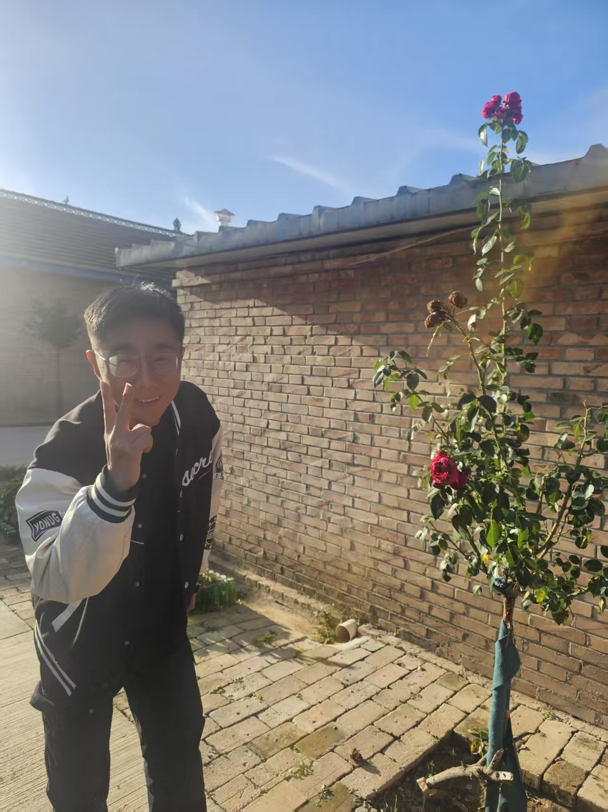
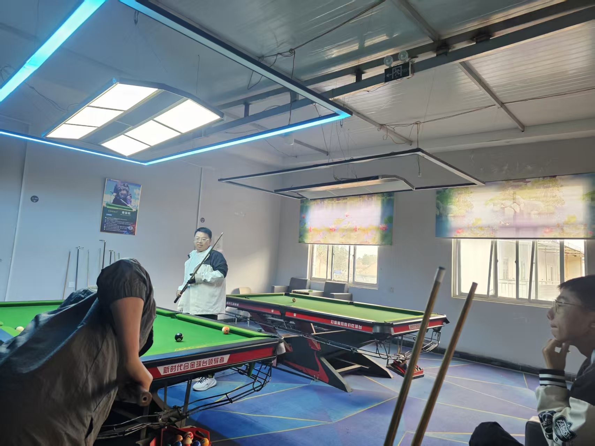

<h1 align="center">Hi 👋, I'm XpHalo</h1>
<h3 align="center">A passionate developer building awesome projects</h3>

  

---

### 🛠️ Tech Stack

---

### 📊 GitHub Stats

<!-- 如果图片直接放在仓库根目录下 -->
![我的统计图]

<!-- 如果图片放在 assets 文件夹中 -->
<!--img src="./images/jianwei.png" width="400" alt="Stats" />

-->
    
